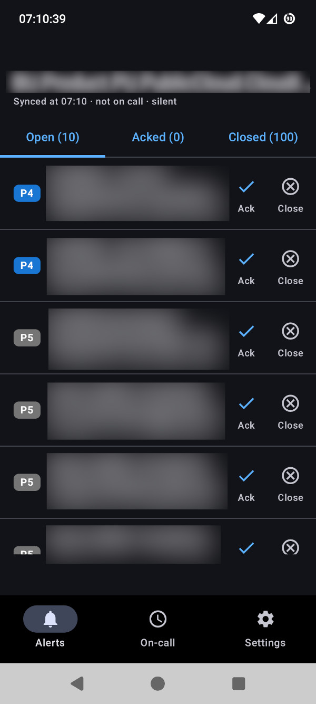
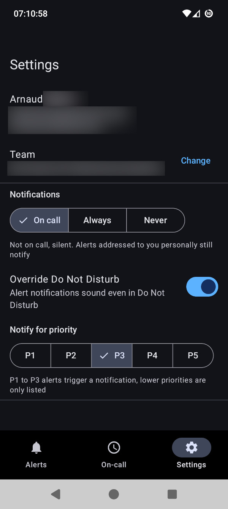

<p align="center"></p>

# Jicrade

An Android app to receive and handle **Jira Service Management Operations** alerts, for teams
whose Opsgenie mobile app went away with the Opsgenie retirement.

> **Development build.** This is an early, personal project. Expect bugs and breaking changes,
> and do not rely on it as your only on-call alerting channel.

<p align="center">
  
  &nbsp;&nbsp;
  
</p>

## Features

- Your team's alerts in Open, Acked and Closed tabs, with details, notes and activity log.
- Acknowledge, unacknowledge, close, snooze and add notes, from the app or the notification.
- Who is on call now and next for each of your team's schedules, and when your next shift is.
- Notifications that follow your on-call schedule: loud while you are on call, silent otherwise,
  unless an alert is addressed to you. Can be forced to Always or Never.
- Priority threshold (P3 and above by default) and an optional Do Not Disturb override.

## Getting started

1. Create an Atlassian API token at <https://id.atlassian.com/manage-profile/security/api-tokens>.
2. Build and install the app (see below), then sign in with your site name (`mycompany` for
   `mycompany.atlassian.net`), your Atlassian email and the token, and pick your team.
3. Allow notifications, and in Settings exempt the app from battery optimisation so polling
   keeps running with the screen off.

The token is stored encrypted on the device and only sent to `api.atlassian.com` and your
`atlassian.net` site.

## How it works

The app uses the [JSM Operations REST API](https://developer.atlassian.com/cloud/jira/service-desk-ops/rest/v2/intro/)
directly, with Basic authentication. That API has no push channel for third-party apps, so the
app polls: every 15 minutes in the background, and every 30 seconds to 5 minutes while you are
on call, through a foreground service that starts and stops with your shifts.

## Building

Requires JDK 17 or later and the Android SDK with platform 35.

```sh
echo "sdk.dir=/path/to/Android/Sdk" > local.properties
./gradlew test assembleDebug
adb install -r app/build/outputs/apk/debug/app-debug.apk
```

The version code is derived from the git commit count, so each new commit installs as an update.

## Releases

Every push and pull request is tested and built by GitHub Actions; the APK is attached to the
run. Pushing a tag starting with `v` publishes a GitHub release with the APK (tags containing a
`-`, like `v0.2.0-rc1`, are marked as pre-releases):

```sh
git tag v0.2.0
git push origin v0.2.0
```

Releases are debug builds signed with `app/debug.keystore`, which is committed on purpose so
that every build, local or CI, can upgrade the previous one.

## License

Apache License 2.0, see [LICENSE](LICENSE).

Not affiliated with or endorsed by Atlassian. Jira Service Management and Opsgenie are
trademarks of Atlassian.
